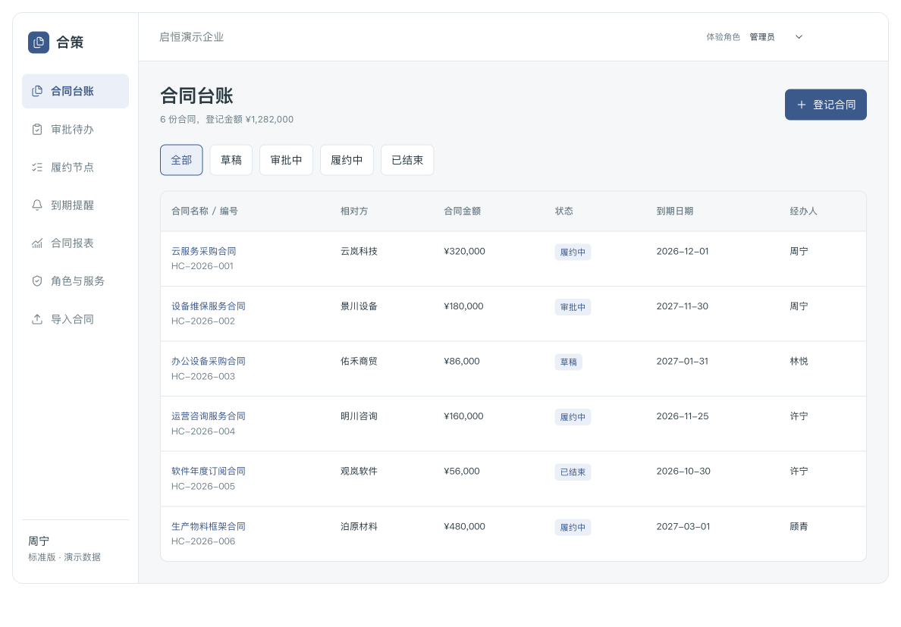
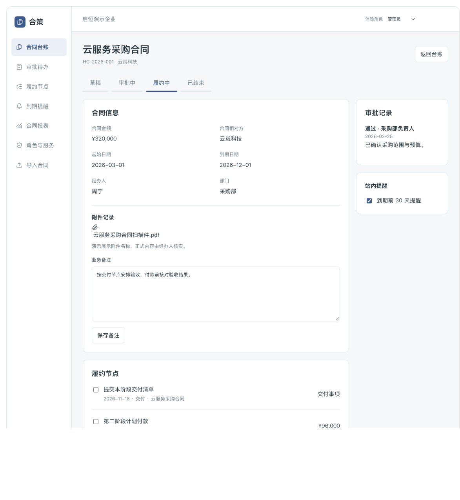
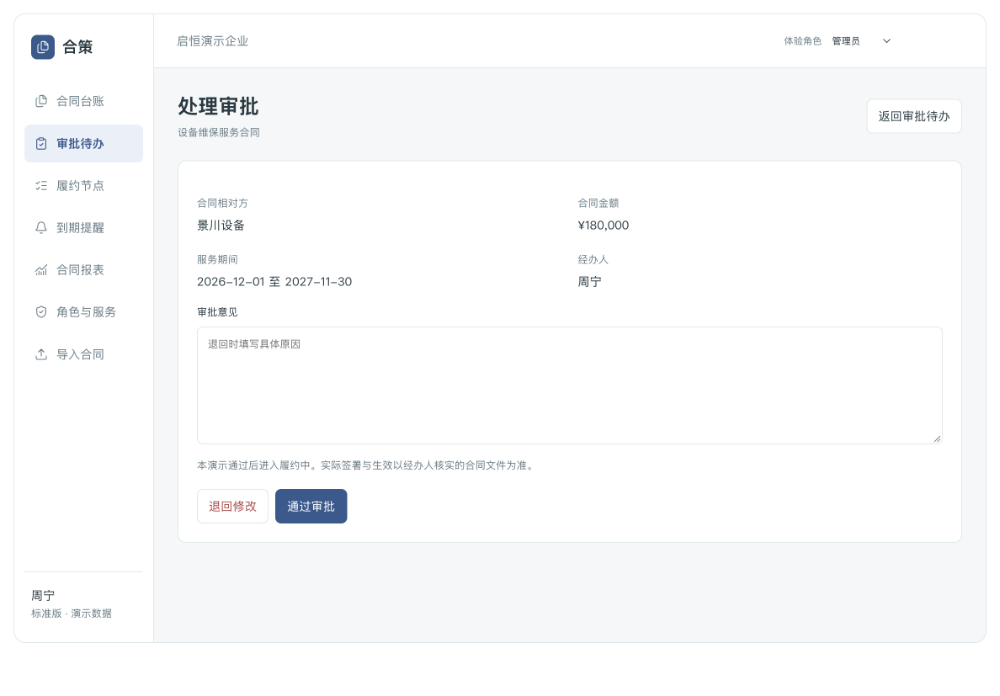
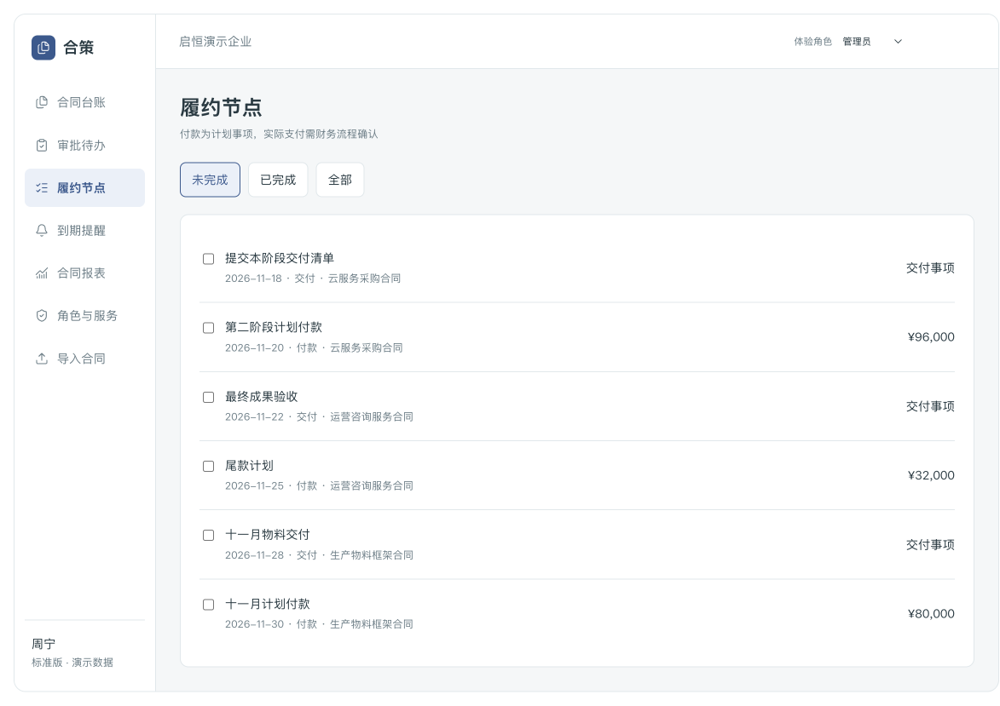
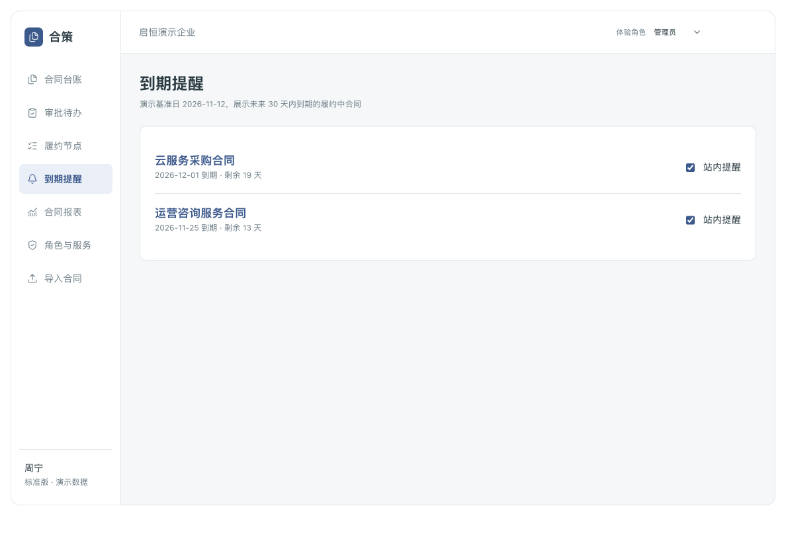
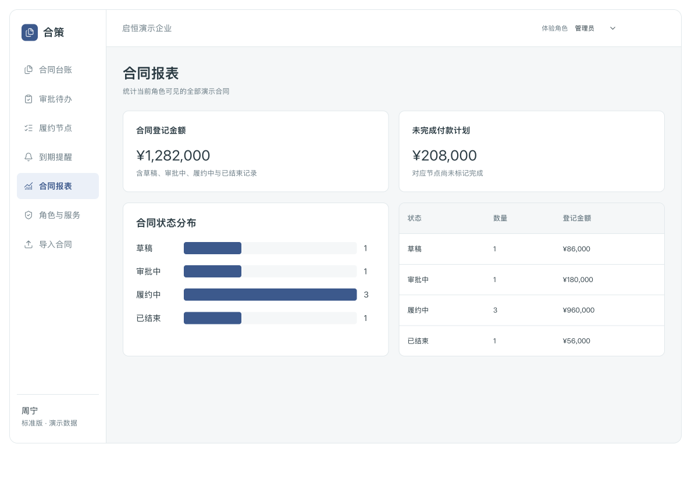
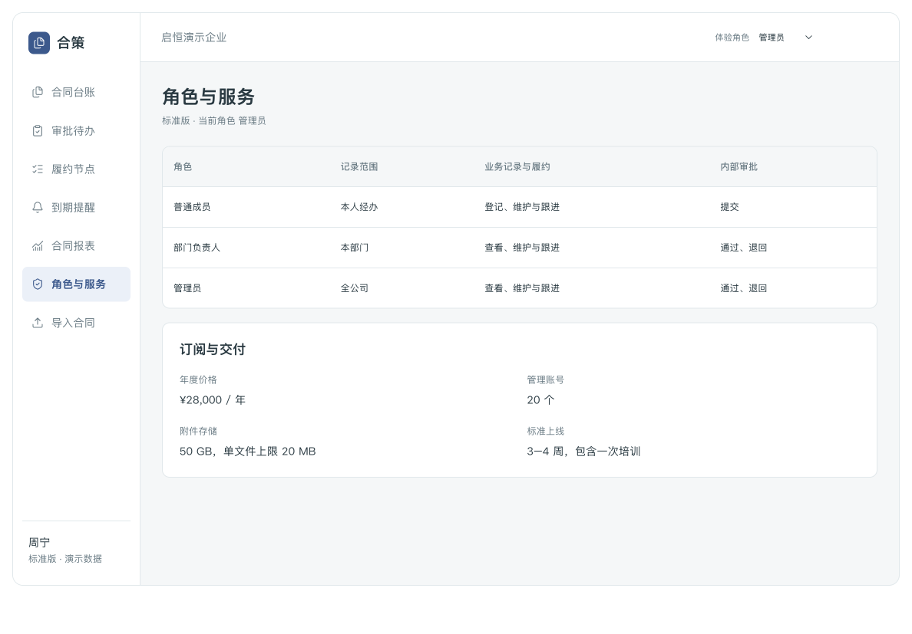
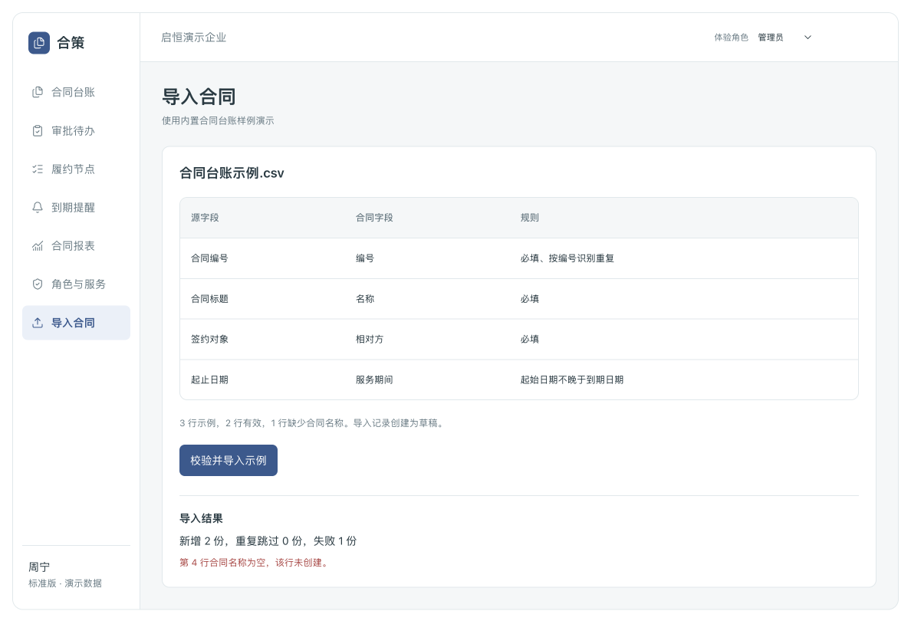

# 合策合同管理产品介绍书

销售培训资料草稿 v0.2，编写日期为 2026-11-12。

合策合同管理是为销售陪练编写的虚构企业软件。本文中的功能组合、价格、账号与容量额度、审批方式、试用、交付及服务条款均为训练设定，供学员学习和查阅。功能形态参考真实合同管理产品的官方资料，参考依据见文末。

配套的 [合策合同管理产品界面演示](ui-prototype.html) 包含合同台账、审批待办、履约节点、到期提醒、合同报表、权限及示例导入。文中配图由演示界面生成，人物、公司和合同数据均为虚构。演示支持核心操作，完整产品范围以本文的文字设定为准。

## 产品概述

合策帮助企业统一登记合同、安排内部审批、跟踪付款与交付等履约节点，并查看合同到期及统计情况。合同经办人在台账中维护基本信息和责任人，部门负责人根据权限处理审批、检查履约进展，管理员配置人员与数据范围。

标准版采用云端订阅方式，通过电脑浏览器使用，适合存在多名经办人、多个合同类别及跨人员交接需求的企业。典型客户包括需要持续管理供应商、服务采购、设备采购和业务合作协议的企业。

常见采购动因包括合同表格与附件分散、审批进度需要反复询问、付款或交付节点依赖个人记忆、续约讨论启动过晚，以及负责人难以按统一口径了解合同情况。产品把这些事项集中为可以查找、分配和跟踪的记录。

合同状态表示企业内部的管理进展，实际签署、生效、付款及履行情况由经办人依据相应文件和业务事实维护。内部审批、签署确认和财务执行需要各自有明确的责任人。

## 产品功能

### 合同台账

为每份合同建立唯一编号，登记合同名称、对方单位、类别、金额、开始与结束日期、所属部门和经办人。可以按状态查找合同，进入详情查看基本字段、附件名称、履约节点、审批记录和备注。

新增合同先保存为草稿。经办人核对基本信息、附件及需要推进的事项后提交内部审批。已登记的合同可持续维护业务备注，便于交接人员了解后续安排。

合同编号用于在批量导入和后续整理时识别同一份记录。补充协议或续约协议如需单独登记，应使用各自明确的编号，并在备注中说明相关合同关系。合同金额按当前记录填写的人民币金额管理。

### 内部审批

标准流程包含提交、通过和退回。只有处于审批中的合同才进入审批待办，部门负责人或系统管理员在自己的数据范围内处理。通过后合同进入履约中，退回后回到草稿，退回时填写具体原因。

审批记录保留处理结果与意见，便于经办人确认需要补充的内容。例如，负责人可以要求补齐交付验收条件、确认预算归属，或核对供应商信息后重新提交。

演示把审批简化为一次负责人处理，用于观察状态与待办变化。涉及多级会签、金额条件路由、外部法务服务或其他系统审批的需求，应提供实际流程再评估范围、费用和工期。

### 履约节点

为合同登记交付、验收、付款及其他需要跟踪的事项，记录节点名称、计划日期、负责人和完成状态。付款计划还可记录对应金额，便于责任人在约定时间前准备资料和推进办理。

节点完成由有权限的人员依据实际业务办理情况登记。任务列表与合同详情使用同一个节点状态，完成后两处同步更新。发现误勾选时，可恢复为未完成并补充备注说明。

计划付款金额用于安排和跟踪待办。实际支付、财务记账、开票及核销需要对应系统或人员确认。交付和验收节点也应按真实交接结果维护。

### 到期提醒

根据合同结束日期，列出需要提前关注的有效履约合同。提醒由合同负责人接收，标准渠道为站内通知，可按合同启用或停用。

演示以 2026-11-12 为固定基准日，展示结束日期位于该日至 2026-12-12 之间、状态为履约中的合同，供学习者观察未来 30 天的到期情况。演示开关用于展示配置状态，定时调度与实际通知属于完整产品设定。

续约或终止决定需要业务负责人根据合同条款、合作情况及内部流程作出。提醒帮助提前发起讨论，经办人继续维护沟通结论和后续动作。

### 报表

按当前角色可见范围统计合同数量、合同金额和待完成付款计划。状态、金额或节点完成情况改变后，相关列表与统计同步更新。

金额统计的口径随报表说明呈现。一个企业对方可以有多份合同，合同数量按记录数计算。报表用于管理台账和计划进度，实际现金流及财务确认应结合对应记录核对。

### 权限与附件

普通成员查看本人负责的记录，部门负责人查看本部门记录，系统管理员查看全公司记录。审批操作由部门负责人和系统管理员执行。合同详情、关联履约节点及统计均遵循对应记录的可见范围。

每个企业包含 50 GB 附件存储，单个附件最大 20 MB。标准产品支持在合同记录下归集合同文本及相关资料，并按合同权限访问。演示以附件名称展示资料归属，便于理解档案关系。

不同部门如需交叉查看、集团内多主体隔离、复杂外部共享或专用部署，应在需求确认时提供实际组织结构、协作场景及安全要求进行评估。

## 界面与操作说明

### 合同台账与状态

台账列表是日常查找合同的入口。经办人可以根据合同名称、对方单位、状态和负责人识别记录，再进入详情查看具体内容。开始工作时，先确认自己当前使用的角色与可见范围。

| 管理状态 | 在产品中的含义 | 可以继续推进的事项 |
| --- | --- | --- |
| 草稿 | 经办人正在准备或补充登记信息 | 核对基本字段、附件与计划，提交内部审批 |
| 审批中 | 已提交负责人处理，审批结果待确认 | 负责人查看资料并选择通过或退回 |
| 履约中 | 已完成演示中的内部审批，正在持续跟踪后续事项 | 维护实际签署信息、履约计划及到期安排 |
| 已结束 | 该合同的内部管理跟踪已结束 | 保留档案与历史处理内容供回看 |

在实际使用中，开始履行前应由经办人确认外部签署与生效条件已满足，并据此安排节点。演示中“通过后进入履约中”用于展示简化的管理流转。

新合同登记后先进入草稿。提交审批前应检查编号、对方单位、合同金额、起止日期及责任人，确保负责人能够识别所处理的事项。

### 合同详情

详情把一份合同的基本信息、附件、履约计划、审批记录和业务备注放在同一位置。经办人交接时可以沿着这些信息了解约定范围、已处理事项和下一步责任。

| 字段或区域 | 展示及填写内容 | 使用规则 |
| --- | --- | --- |
| 合同编号 | 企业统一识别编号 | 同一企业内保持唯一，导入时用于检查重复 |
| 合同名称 | 便于识别的业务名称 | 能说明采购、服务或合作事项 |
| 对方单位 | 合同相对方的企业名称 | 依据实际文件确认，避免简称混淆 |
| 合同类别 | 采购、服务或其他已配置类别 | 用于整理台账和比较同类合同 |
| 合同金额 | 当前记录维护的人民币金额 | 合同变更后按内部确认流程更新 |
| 起止日期 | 约定开始与结束时间 | 结束日期用于到期范围计算 |
| 所属部门与负责人 | 负责管理的部门和经办人 | 同时关联权限范围及处理责任 |
| 附件 | 合同文本及相关资料 | 按合同权限访问，遵守容量及文件限制 |
| 履约节点 | 待办事项、计划日期、金额及完成状态 | 按实际办理情况更新 |
| 审批记录与备注 | 处理结果、退回原因及后续业务说明 | 便于追踪内部处理及人员交接 |

备注应记录具体事实和待确认事项，例如验收资料是否已收到、发票信息是否已核对、下一次与对方沟通的安排。付款计划、实际付款凭证和业务备注之间应有可核对的关系。

### 审批待办

审批待办集中展示当前范围内状态为审批中的合同。负责人可从列表进入合同详情，查看基本字段、资料和既有记录，再作出处理。

选择通过后，合同进入履约中并从审批待办中移出。选择退回时，需要填写可供经办人采取行动的原因，合同回到草稿。经办人补充资料后可再次提交。

普通成员可以提交自己负责的草稿并查看处理结果。部门负责人处理本部门范围内的审批，系统管理员处理全公司范围内的审批。对已经处理完成的合同，后续进入页面时应根据当前状态继续工作。

审批通过表示完成当前产品设定的内部处理。实际签章、法律审查与付款授权仍由对应流程和责任人员完成，销售介绍时应先了解客户希望串联的业务步骤。

### 履约节点

履约页面按计划列出需要推进的合同事项。人员可以查看节点关联的合同、负责人、日期及完成状态，再回到详情核对具体约定。

一个合同可以有多个节点，例如设备到货、安装验收、首付款资料准备和尾款申请。节点名称应说明具体动作，日期应对应已确认的业务计划，付款节点金额使用统一单位。

勾选完成时，处理人员需要依据实际交付或办理结果确认。完成状态在节点列表和合同详情中同步变化。合同金额、付款计划合计和实际支付可能采用不同口径，出现差异时应核对相应约定及变更记录。

### 到期提醒

到期列表帮助负责人在合同结束前组织续约、重新议价或终止安排。页面应结合合同名称、对方单位、结束日期和责任人使用，避免只关注日期而遗漏采购周期。

演示采用固定基准日和未来 30 天窗口，方便重复观察同一组数据。履约中合同的结束日期落入窗口后列入对应范围，已结束合同按照其状态保留在台账中。

启用提醒后，标准产品按配置向对应负责人发送站内通知。停用时应由责任人员确认后续安排，避免提醒设置与实际管理需要脱节。邮件、短信、企业微信等渠道如有要求，需要在方案中单独确认。

### 合同报表

报表按当前角色可见合同实时聚合。切换体验角色后，普通成员、部门负责人和管理员看到的数据范围可能不同。

| 指标 | 产品定义 | 核对方法 |
| --- | --- | --- |
| 合同数量 | 当前可见的合同记录数 | 与同一范围内台账记录对应 |
| 状态分布 | 各管理状态的合同数量 | 审批通过或退回后检查对应状态变化 |
| 合同金额 | 当前范围合同记录的金额合计 | 按合同记录口径逐笔核对 |
| 待完成付款计划 | 未完成付款节点中维护的计划金额合计 | 与关联节点及其完成状态核对 |
| 近期到期 | 演示基准日未来 30 天内到期的履约中合同 | 对照合同结束日期与状态 |

报表按当前保存的字段计算。发现统计与实际不符时，应先确认数据范围、合同状态、金额单位和节点是否及时更新，再排查导入与关联问题。

### 权限管理

权限页说明三种角色的数据范围和关键操作差异。演示角色切换用于理解记录隔离，客户开通时由管理员按组织结构配置真实人员。

| 操作 | 普通成员 | 部门负责人 | 系统管理员 |
| --- | --- | --- | --- |
| 查看合同及关联资料 | 本人负责记录 | 本部门记录 | 全公司记录 |
| 登记合同及提交草稿 | 按本人范围 | 按部门范围 | 按全公司范围 |
| 审批通过或退回 | 查看结果 | 在部门范围处理 | 在全公司范围处理 |
| 维护履约与备注 | 在本人记录范围内 | 在部门记录范围内 | 在全公司记录范围内 |
| 查看报表 | 本人数据 | 部门数据 | 全公司数据 |
| 人员、权限与特殊访问配置 | 由管理员管理 | 提交配置需求 | 管理配置 |

可见范围应同时适用于列表、详情、关联节点和报表。人员调岗或离职前，管理员应确认记录负责人及未完成事项的接收人，再完成交接。

## 数据导入说明

### 模板与字段

已有合同台账可以先按标准模板整理，再执行批量导入。先选择少量样例验证编号、日期、部门和责任人映射，确认后分批处理历史数据。

| 文件字段 | 整理要求 | 需要核实的事项 |
| --- | --- | --- |
| 合同编号 | 每条记录有明确编号 | 与已有记录重复时按选定规则处理 |
| 合同名称 | 使用可识别的业务名称 | 避免多份合同共用模糊名称 |
| 对方单位 | 统一企业名称 | 简称与全称需先对应 |
| 金额 | 数字格式，统一人民币元 | 不把万元与元混用 |
| 开始日期与结束日期 | 采用统一日期格式 | 对照原文件核对时间 |
| 所属部门 | 与系统组织配置对应 | 旧部门名称需要映射 |
| 负责人 | 与已开通人员对应 | 历史离职人员需明确接收人 |
| 附件与节点 | 明确对应的合同编号 | 在迁移前评估文件及关联方式 |

### 校验与重试

导入前确认字段映射，校验必填项、数字、日期和重复编号。结果中应明确成功、跳过及失败的数据，并给出可定位的行和原因。

演示使用 3 行内置数据，首次执行展示两条成功、一条失败。再次导入时，两条已存在的有效记录按编号识别并跳过，失败记录仍需修正。完整迁移方案应先确认新增、更新及重复处理策略。

缺少编号、负责人无法匹配或日期格式错误，都可能影响导入结果。修正前应核对记录是否已经创建、是否仅关联字段失败，再决定重试范围。合同附件、历史审批链、复杂自定义字段及其他系统数据，需要单独评估迁移方法。

## 业务场景与产品价值

| 业务现状 | 可以展示的能力 | 需要客户配合的条件 |
| --- | --- | --- |
| 合同文件分散，查找依赖原经办人 | 统一台账、附件归集及负责人信息 | 整理有效合同，确认编号与资料归属 |
| 审批需要在邮件和聊天中反复询问 | 审批待办、处理结果和退回原因 | 明确内部负责人及标准处理流程 |
| 交付与付款节点依赖个人记忆 | 关联履约计划、截止日期及完成状态 | 先确认实际节点和责任人 |
| 临近到期才讨论续约 | 到期窗口及站内提醒 | 维护准确结束日期，安排足够的采购准备时间 |
| 部门负责人难以了解合同进展 | 状态分布、金额及未完成付款计划 | 统一金额口径，及时维护业务记录 |
| 经办人交接后信息不完整 | 合同详情、审批记录与备注 | 把实际沟通和待办持续记录到对应合同 |

这些能力帮助建立可追踪的管理过程。能节省多少整理时间、减少多少遗漏，应结合客户的合同数量、现有流程和试用情况评估。

## 价格与商务条件

以下均为合策训练产品的虚构含税人民币报价及服务条件。

| 项目 | 标准条件 |
| --- | --- |
| 年度订阅 | 28,000 元，服务期 12 个月 |
| 账号范围 | 包含 20 个实名管理账号 |
| 账号计算 | 有独立登录账号的经办人、负责人和管理员均占用名额 |
| 附件存储 | 企业共用 50 GB，单个附件最大 20 MB |
| 功能范围 | 本文列明的标准台账、内部审批、履约、提醒、报表及权限 |
| 标准服务 | 基础配置指导、标准表格导入指导、一次线上培训 |
| 付款安排 | 标准为按年预付，其他付款方式需审批确认 |
| 报价有效期 | 书面报价出具后 30 天 |

例如，客户计划安排 12 名经办人、6 名负责人和2名管理员，合计20个独立账号，采用标准版年度订阅时费用为28,000元。人数、容量或服务范围超过标准配置时，应确认实际用量并另行报价。

额外账号、存储扩容、多级审批定制、财务或电子签章系统对接、专用部署及复杂迁移需要单独评估。折扣、赠送账号和额外服务须经销售主管确认，并在书面报价或合同中列明。

### 试用安排

提供 14 天标准功能试用，最多开通 5 个试用账号。可用示例合同数据验证流程，也可由客户准备一小批经过授权、适当处理的资料。

试用前由双方确认重点，例如登记一份草稿并提交、由负责人处理、查看履约节点、检查一份近期到期合同，以及切换不同角色核对可见范围。试用结束后记录适配情况及需要进一步确认的需求，再确定正式开通范围。

## 上线与服务

### 标准上线

预计周期为 3–4 周，从客户提交人员名单、组织范围、标准审批方式及合格样表，并完成双方实施范围确认后开始计算。

1. 启动沟通，确认合同类别、管理责任、审批方式和首期上线范围。
2. 建立账号、部门和三类标准角色，确认哪些人员处理审批。
3. 整理历史台账与附件，统一编号、日期、金额单位及负责人映射。
4. 使用少量样例完成导入、审批、履约及提醒流程验证。
5. 对照权限与报表口径检查结果，修正字段和使用规则。
6. 提供一次 2 小时线上培训，确认上线清单及日常支持联系人。

标准服务包含基础配置指导、一次样表检查、标准导入指导和上述培训。客户负责确认实际合同信息、提供合格资料、指定业务责任人与管理员，并完成内部使用安排。

历史数据大量缺失、附件关联复杂、多主体组织、外部审批与财务集成等情况，需另行确认工作量和排期。实际进度还取决于客户的数据准备、流程确认及参与人员安排。

### 验收与支持

验收以双方确认的标准场景为依据，包括账号可用、权限正确、样例合同字段和附件归属正确、审批结果可回看、节点状态联动、到期范围符合配置以及报表可核对。

日常支持时间为工作日 9:00–18:00，可通过在线工单咨询。首次人工响应在 1 个工作日内，完成处理的时间根据影响范围与解决方案单独沟通。

客户需要定期检查权限及负责人，及时维护合同变更、节点办理和到期安排。服务续约、数据交付、终止后的保留及处理方式，应在对应商务文件中书面确认。

## 一次完整使用示例

以下过程用于理解各模块如何配合，具体企业、人物、合同金额和日期均按练习案例设定。

1. 经办人在台账登记一份服务采购合同，补齐对方单位、金额、起止日期及负责部门。
2. 归集合同文本和相关资料，列出交付验收、付款资料准备及续约讨论等需要跟踪的事项。
3. 提交内部审批，负责人查看资料后通过，或填写具体原因退回经办人补充。
4. 经办人依据实际文件确认外部签署与生效情况，继续维护履约计划和责任分工。
5. 节点完成时在对应记录中登记，列表与合同详情同步更新，报表中的待完成计划相应变化。
6. 合同进入到期关注窗口后，负责人提前组织续约、重新议价或结束安排。
7. 内部管理跟踪结束后保留档案、审批结果及备注，供后续查询和交接使用。

这套过程需要经办人持续维护事实，负责人按明确权限处理和检查进展，管理员维护组织、账号及配置。软件提供统一记录和跟踪方式，业务责任由企业实际安排承担。

## 常见产品问题

### 原来的合同表格和文件能否继续使用

可以先按标准模板整理台账，再选少量样例验证。合同编号、负责人、日期和金额需要先统一，附件与历史流程的迁移范围按实际资料评估。

### 是否能够处理公司的全部审批流程

标准版采用本文列明的内部处理流程。需要多级会签、金额条件、跨部门授权或外部系统串联时，应提供实际流程及样例，确认可配置范围与额外工作量。

### 审批通过后是否自动完成签署

审批处理记录表示企业内部的处理结果。实际签章由相应签署流程完成，经办人依据实际文件维护签署、生效及后续履约信息。电子签章系统如需集成，应单独评估接口和服务条件。

### 付款节点完成后是否代表已付款

节点状态由人员维护，应依据实际办理结果更新。银行支付、会计记账、开票及核销由对应业务系统和人员执行，必要时可把凭证归集到合同资料中供核对。

### 能否在手机短信或企业微信收到提醒

标准渠道为站内通知。其他渠道需要确认客户的账号、授权、接收方式、接口及相关服务成本，按评估后的方案约定。

### 能否自动识别合同风险或提供法律判断

标准功能以人工登记、内部审批和履约管理为范围。法律审查由客户安排具备相应职责的人员或专业服务完成，OCR、AI 分析与风险识别等扩展需求需要单独评估。

### 员工调岗后历史合同如何交接

管理员先确认接收人和权限范围，再安排负责人调整及未完成事项交接。接收人员应核对原合同、相关资料、待办节点和最近沟通结论，确保后续责任明确。

## 功能设计参考

集中合同库、处理工作流、履约与续约跟踪的功能形态参考 Docusign CLM 官方资料，文件管理、台账和到期关注的产品组织方式也参考契约锁官方说明。合策的状态、权限规则、简化审批及全部商业数值为独立虚构设定。[Docusign CLM 产品说明](https://www.docusign.com/products/clm)、[Docusign 官方产品简报](https://www.docusign.com/resources/solution-briefs/docusign-clm-datasheet)、[契约锁云平台帮助](https://help.qiyuesuo.com/document/cloud)、[契约锁归档履约说明](https://www.qiyuesuo.com/en-US/znht/detail/3456980570494738510)

具体来源事实与设计范围见 [合策合同管理官方资料参考记录](../../../docs/research/contract-product-references.md)。
