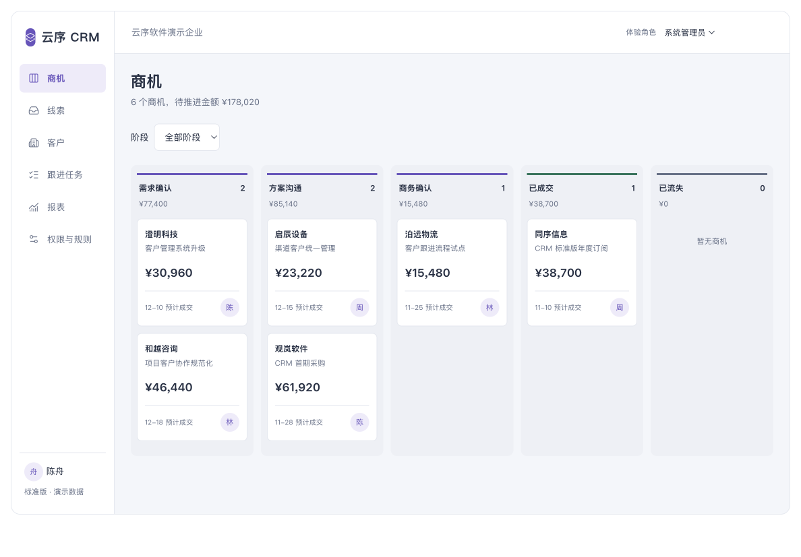
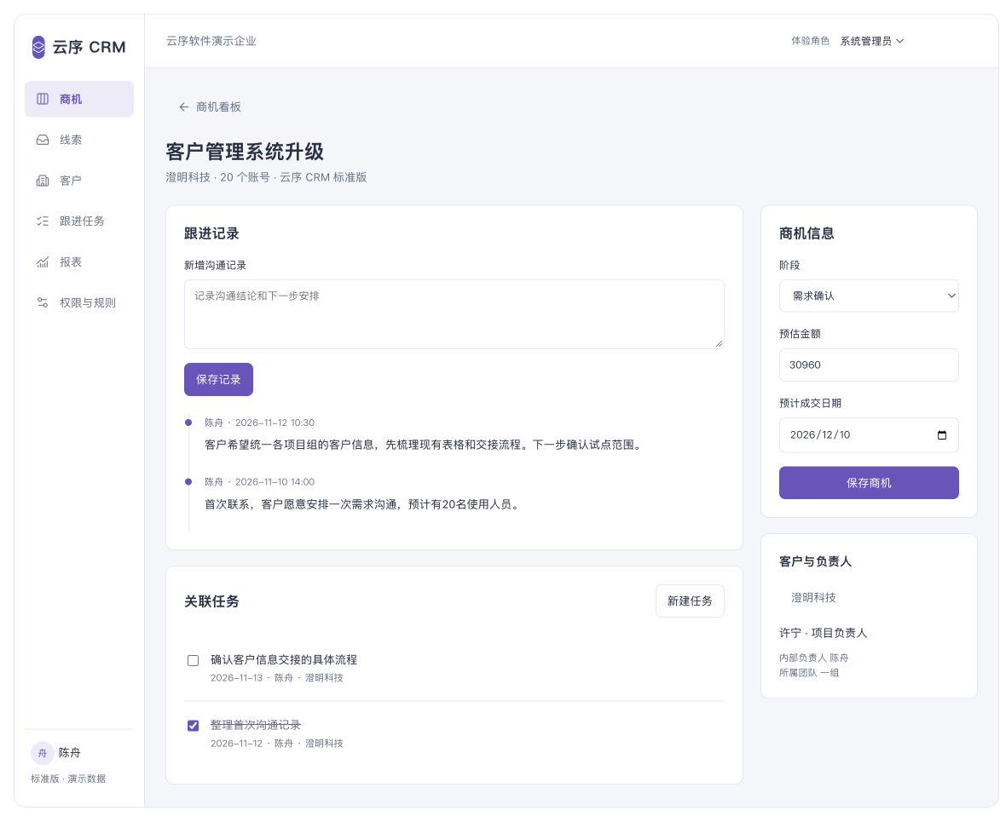
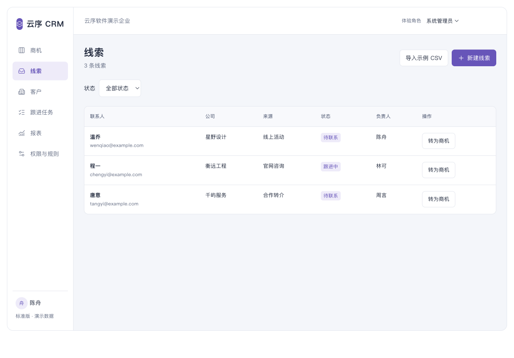
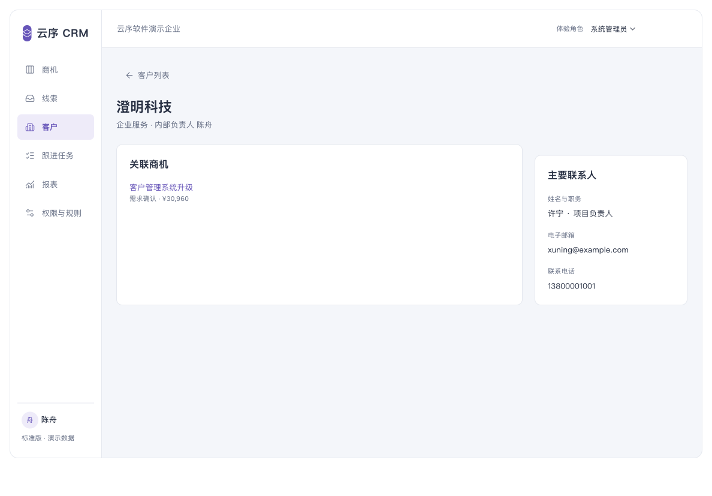
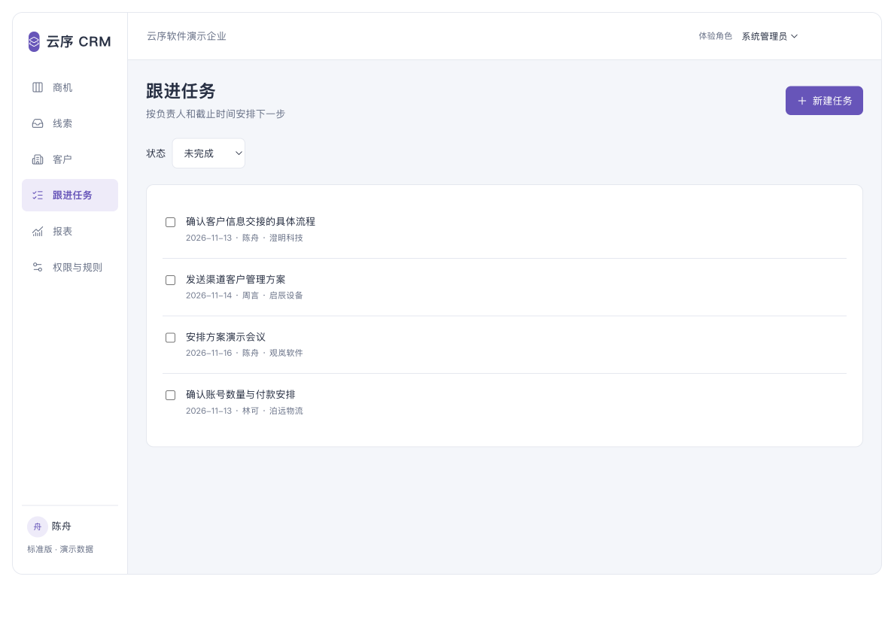
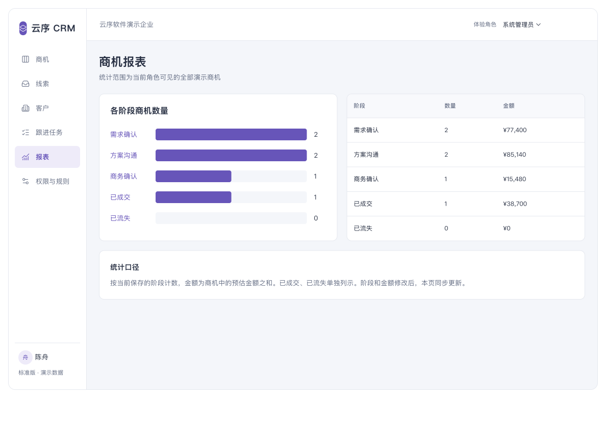
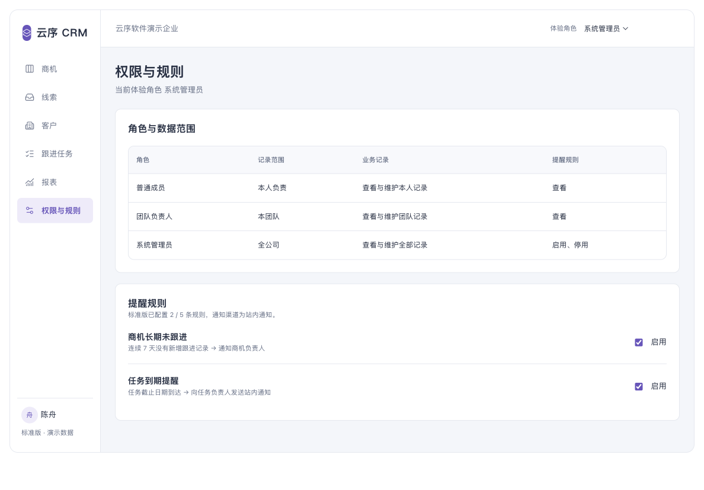
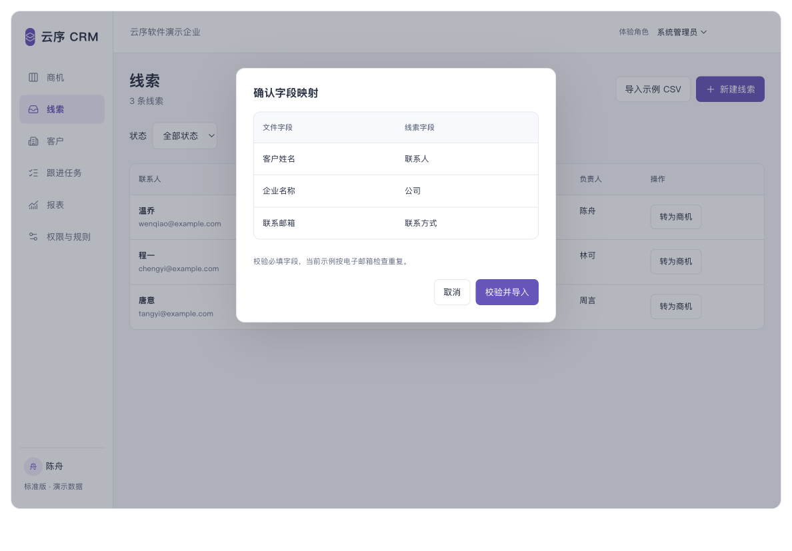

# 云序 CRM 产品介绍书

销售培训资料草稿 v0.2，编写日期为 2026-11-12。

云序 CRM 是为销售陪练编写的虚构企业软件。本文中的功能范围、价格、账号与容量额度、试用、交付及服务条款均为训练设定，供学员学习和查阅。功能形态参考真实 CRM 的官方资料，参考依据见文末。

## 产品概述

云序 CRM 帮助企业集中管理销售线索、企业客户、联系人、商机及跟进任务。销售人员在系统中记录沟通和下一步行动，业务或项目负责人根据权限查看客户进展、交接情况和销售报表。

标准版采用云端订阅方式，通过电脑浏览器使用。适用客户为拥有约 10–100 名销售及相关协作人员的企业，尤其适合正在从表格、邮件和群聊转向统一管理的团队。

典型使用场景包括客户信息归集、线索分配、多人交接、项目型销售跟进及商机进度查看。实际沟通时，对接人可由企业指定为业务负责人、项目负责人或采购负责人。

配套的 [云序 CRM 产品界面演示](ui-prototype.html) 展示商机、线索、客户、跟进任务、报表和权限规则六个模块。文中的界面截图来自这套演示，使用同一组虚构客户与业务数据。演示支持部分核心操作，完整产品范围以本介绍书的文字设定为准。

## 产品功能

### 线索录入与分配

支持手工录入和使用标准 CSV 表格导入线索，记录姓名、公司、联系方式、来源、意向产品和负责人。线索状态包含待联系、跟进中、已转化和无效。

管理员可指定负责人，也可在指定人员范围内设置轮流分配。线索达到继续推进的条件后，可转为企业客户、联系人和商机，并保留关联的跟进记录。

录入时可按联系电话或电子邮箱提示疑似重复，是否合并由有权限的人员确认。重复识别效果取决于字段完整性和统一的录入格式。

### 企业客户与联系人

一个企业客户可以关联多名联系人。联系人可记录职务、负责事项、联系方式和沟通备注，便于识别业务使用人、项目推进人及商务对接人。

企业客户页面集中展示关联联系人、商机、跟进记录和附件。人员交接时，有权限的管理员可转移记录负责人，原有记录继续保留。

### 商机与销售阶段

一个客户可关联多个商机，每个商机单独记录名称、意向产品、预估金额、预计成交日期、负责人及下一步行动。

默认阶段为需求确认、方案沟通、商务确认、已成交和已流失。管理员可调整阶段名称，销售人员根据实际沟通更新阶段，流失时填写原因。

商机可按列表或阶段看板查看，支持按负责人、阶段和预计成交时间筛选。预估金额及阶段由使用人员维护，报表中的金额代表已录入的业务判断。

### 跟进记录与任务提醒

可记录电话、会议、拜访及其他沟通的时间、摘要和下一步安排，并关联到线索、客户或商机。用户可上传相关附件。

跟进任务包含负责人、截止时间、优先级和完成状态。系统提供站内到期提醒和逾期列表，主管可查看权限范围内的待办。

标准版的电话和会议内容由人员填写。个人微信聊天、通话录音以及外部会议记录的自动采集，需要另行评估对应渠道和授权条件。

### 规则提醒

管理员可配置最多 5 条启用中的提醒规则。规则由触发条件及动作组成，例如商机连续 7 天没有新增跟进记录时，通知负责人或创建跟进任务。

标准动作包括创建任务和发送站内通知。涉及跨系统执行、多层审批或定制计算的流程，需要另行评估。

### 报表与看板

提供线索来源及转化情况、各阶段商机数量与金额、负责人商机分布、任务完成及逾期情况等标准报表。

可按时间、负责人和商机阶段筛选，具备导出权限的人员可导出结果。报表根据已保存的数据生成，统计口径随报表说明展示。数据的完整性依赖录入习惯及字段维护。

### 权限与数据管理

标准角色包含普通成员、团队负责人和系统管理员。可设置查看本人、本团队或全公司的业务数据，并分别控制导入、导出和负责人变更等操作。用户的角色与数据范围由客户管理员配置。

线索、客户、联系人及商机支持按模板导入和导出。单次导入最多 10,000 行，导入前校验必填项、日期及关联字段，并提供失败原因供修正后重试。

每个企业包含 50 GB 附件存储，单个附件上限为 20 MB。超出容量或文件限制的需求需另行评估。旧系统中的自定义字段、附件和完整历史活动，需要先核对格式及关联方式。

## 界面与操作说明

### 商机看板与详情

商机看板按五个业务阶段排列，每一列显示该阶段的商机数量及预估金额合计。卡片包含企业名称、商机名称、预估金额、预计成交日期及内部负责人，点击卡片进入详情。顶部“待推进金额”仅统计需求确认、方案沟通及商务确认三个阶段。

以“澄明科技”的“客户管理系统升级”商机为例，界面中显示 20 个账号、30,960 元年度订阅预估金额，当前处于需求确认阶段。销售可以打开详情查看此前沟通、补充下一步任务，并在客户需求和方案逐步明确后更新阶段。

| 界面位置 | 展示或填写的内容 | 用途与规则 |
| --- | --- | --- |
| 标题区域 | 商机名称、所属客户、账号数和产品 | 识别本次业务机会，同一客户可以有多笔商机 |
| 跟进记录 | 沟通时间、记录人、沟通结论与下一步安排 | 保留沟通过程，便于复访和交接 |
| 关联任务 | 待办事项、截止日期、内部负责人及完成状态 | 把下一步落实为可以跟踪的动作 |
| 阶段 | 需求确认、方案沟通、商务确认、已成交、已流失 | 保存后移动看板卡片并更新阶段统计 |
| 预估金额 | 本次商机的预计合同金额 | 可随账号数和方案调整，报价以书面确认内容为准 |
| 预计成交日期 | 预计达成采购约定的日期 | 用于安排跟进节奏，定期根据实际情况更新 |
| 流失原因 | 预算、时机、方案适配或其他具体原因 | 进入已流失阶段时填写，便于后续分析 |
| 客户与负责人 | 企业客户入口、主要联系人、内部负责人及团队 | 区分甲方联系人和本企业跟进责任人 |

在演示中可修改阶段、金额和预计成交日期，点击“保存商机”。修改后的内容会同时反映在看板和报表中。沟通记录与任务分别保存，写下“下周联系”后，还可以建立有明确截止日期的跟进任务。

### 线索的录入与转化

线索列表展示联系人、联系方式、公司、来源、状态和内部负责人。通过状态筛选查找待联系、跟进中或已转化的记录。

新增线索时，先录入联系人、公司和联系方式。标准产品还可维护来源、意向产品、负责人及状态。对尚未核实的公司规模、预算和购买时间，可在后续沟通中补充。

当线索形成明确的业务机会时，可建立企业客户、联系人和商机之间的关联。例如，展会收集到一名联系人，在确认公司、负责事项和继续沟通意愿后，将其转为商机，随后在商机中维护需求、方案与商务进展。

| 线索状态 | 对应情况 | 可采取的动作 |
| --- | --- | --- |
| 待联系 | 已有线索，尚待首次沟通 | 分配负责人并安排首次联系 |
| 跟进中 | 已开始沟通，仍在核实机会 | 补充业务背景、关键联系人与下一步 |
| 已转化 | 已建立关联客户及商机 | 在商机中继续跟进，保留原线索来源 |
| 无效 | 信息错误、重复或不适配 | 记录原因，便于整理来源质量 |

“转为商机”用于建立后续跟进对象。销售仍需要核实实际需求、使用范围、账号数量和预计采购安排。界面演示会创建示例商机，正式的商机字段应按实际沟通维护。

### 客户档案与联系人

客户列表以企业为主体，点击企业名称查看档案。客户详情展示主要联系人的姓名、职务、邮箱和电话，以及关联商机。通过商机入口可继续查看对应沟通及任务。

同一企业可能同时有业务使用人、项目推进人和商务对接人。标准产品允许维护多名联系人及其负责事项，演示界面先展示主要联系人。

例如，项目负责人关心方案能否落地，使用部门关心录入和查找是否方便，采购负责人关心费用、服务范围和交付条件。这些关注点需要在沟通中核实，销售可以在联系人负责事项和跟进记录中持续维护。

### 跟进任务

跟进任务页面集中展示未完成或已完成事项。每条任务显示任务名称、截止日期、内部负责人及关联客户，便于销售安排当天工作。

创建任务时，填写具体动作、选择关联商机并设置截止日期。例如“确认试用人员名单”“发送标准功能演示安排”或“与客户核对报价中的账号数量”。任务负责人沿用该商机的内部负责人。

在列表中勾选完成后，商机详情中的对应任务同步更新。取消勾选可恢复为未完成。跟进记录用于记下已经发生的沟通，任务用于安排接下来要完成的动作。

### 报表与统计口径

报表页面展示当前角色可见商机的阶段数量和金额。点击阶段名称可回到对应阶段的商机看板，查看构成该统计值的具体机会。

| 指标 | 本产品定义 | 使用时应注意的条件 |
| --- | --- | --- |
| 商机数量 | 当前统计范围内的商机记录数 | 同一企业可有多条商机，数量与企业客户数不同 |
| 阶段数量 | 当前处于某个阶段的商机数 | 按保存时的当前阶段计算 |
| 阶段金额 | 该阶段所有商机的预估金额之和 | 预估金额需要销售持续维护 |
| 待推进金额 | 三个开放阶段的金额合计 | 代表在跟进机会的规模，尚需继续推进 |
| 已成交金额 | 标记为已成交的商机金额合计 | 财务收款、开票与会计确认需对应系统记录 |
| 逾期任务 | 截止日期已过且尚未完成的任务 | 任务需先设置明确日期，标准产品提供逾期视图 |

系统管理员角色下，演示初始数据共有 6 个商机，开放阶段 5 个，待推进金额为 178,020 元，另有一笔 38,700 元的已成交商机。保存阶段或金额修改后，这些统计同步变化。

### 权限与提醒规则

权限页面展示三类标准角色的记录范围及操作差异。演示右上角的“体验角色”可切换角色，观察列表和报表随权限范围发生的变化。

| 项目 | 普通成员 | 团队负责人 | 系统管理员 |
| --- | --- | --- | --- |
| 可查看的业务记录 | 本人负责 | 本团队 | 全公司 |
| 客户、商机与任务维护 | 在本人记录范围内 | 在团队记录范围内 | 在全公司范围内 |
| 报表数据 | 与本人记录范围一致 | 与团队记录范围一致 | 全公司 |
| 提醒规则 | 查看已配置规则 | 查看已配置规则 | 配置、启用和停用 |
| 导入、导出 | 由管理员授权 | 由管理员授权 | 管理相关授权 |
| 人员交接与负责人转移 | 由管理员授权 | 由管理员授权 | 管理相关授权 |

客户在开通时确认团队、角色和授权方式。拥有导出能力的人员导出数据时，仍按其数据范围执行。具体需要哪些跨团队协作权限，应在配置前确认。

提醒规则最多启用 5 条。以“商机连续 7 天没有新增跟进记录”为例，规则检查商机活动时间，并向内部负责人发送站内通知，或按已配置动作创建任务。启用规则前要明确触发条件、接收人和通知渠道。演示中的开关用于展示配置状态，定时触发属于完整产品设定。

## 数据导入说明

### 导入前准备

先选择数据类型，使用该类型的标准模板整理文件。线索模板需要联系人、公司和联系方式，客户模板还需确认企业名称及内部负责人，商机模板需确认所关联客户、商机名称、阶段及金额。

联系人可以与企业客户关联，商机可以与企业客户和联系人关联。批量迁移前，先统一关联标识及重复判断方式，再用少量样例确认结果。

| 文件中的内容 | 标准导入要求 | 示例 |
| --- | --- | --- |
| 表头 | 每列含义明确，映射到对应字段 | “企业名称”映射为客户公司 |
| 联系方式 | 线索至少有一种可用联系方式 | 联系邮箱或电话 |
| 内部负责人 | 与已开通的人员匹配 | 陈舟 |
| 日期 | 使用统一日期格式 | 2026-12-10 |
| 金额 | 使用可识别的数字，单位统一为人民币元 | 30960 |
| 关联客户 | 使用确认后的客户标识匹配 | 对应同一企业客户记录 |
| 重复数据 | 按选定标识检查后由人员确认处理方式 | 联系邮箱相同的疑似重复线索 |

### 字段映射与结果处理

导入流程为选择文件、确认字段映射、校验、执行导入和查看结果。单批最多 10,000 行，超出的数据应拆分处理。

演示使用 3 行内置数据，展示字段映射、必填校验、重复检查和结果反馈。首次执行会新增两条有效线索，第三条因缺少联系方式而失败。再次执行时，两条已存在的有效线索会被识别为重复并跳过。

完整产品的结果报告应标明新增、更新、跳过和失败的数量。发生字段或关联异常时，需要指出受影响的行、字段及处理结果，以便判断记录是否已经创建。修正失败数据后，可按对应规则重新导入。

| 常见情况 | 影响 | 处理方式 |
| --- | --- | --- |
| 必填字段为空 | 该行无法创建 | 补齐后重试 |
| 日期或金额格式不符 | 对应字段校验失败 | 统一格式并核对单位 |
| 负责人无法匹配 | 记录无法按原计划分配 | 先开通人员或调整映射 |
| 关联客户无法匹配 | 联系人或商机关联不完整 | 确认客户记录及关联标识 |
| 检出疑似重复 | 需要确认新增、跳过或合并策略 | 对照联系方式和公司核实 |
| 附件或历史活动格式特殊 | 可能需要专门迁移处理 | 提供样本评估范围和费用 |

## 一次完整使用示例

以下过程用于理解各模块如何配合，示例企业及人物均为虚构。

1. 收到咨询后建立线索，记录联系人、公司、来源及负责销售。
2. 完成首次沟通，补充业务现状、主要问题和下一步约定，安排后续任务。
3. 确认存在可推进的需求后，建立企业客户、联系人及商机之间的关联。
4. 在商机中记录初步使用范围、账号数、预估金额及预计成交日期。
5. 根据客户的实际反馈推进方案，持续保存沟通记录，并为演示、试用和报价安排任务。
6. 商务条件变化时更新商机字段，负责人通过看板和报表了解最新情况。
7. 达成采购约定后将商机更新为已成交。若当前机会结束，则填写流失原因，保留客户与沟通记录供后续回看。

这一流程要求销售把沟通转化为可靠记录和明确行动。管理员负责前期配置与授权，负责人负责统一业务阶段和统计口径，团队成员负责及时维护实际进展。

## 业务场景与产品价值

| 客户遇到的情况 | 可介绍的能力 | 使用前提 |
| --- | --- | --- |
| 新线索无人跟进，或多人重复联系 | 负责人分配、疑似重复提示、跟进任务 | 确认分配规则，保持联系方式完整 |
| 客户信息散落，换人后难以交接 | 企业客户档案、关联联系人、跟进记录与负责人转移 | 将关键沟通及时录入，并配置交接权限 |
| 负责人需要逐个询问项目进展 | 商机阶段、下一步行动、阶段看板 | 各阶段含义一致，负责人及时更新 |
| 有些机会长时间没有推进 | 到期提醒、逾期列表和规则提醒 | 任务有明确负责人及截止时间 |
| 周报需要反复整理表格 | 标准报表、筛选与导出 | 先统一字段与统计口径 |

上述价值描述提供产品与业务问题的对应关系。具体能节省多少时间、改善多少转化率，应结合客户现状和试用结果评估。

## 价格与商务条件

以下金额均为本训练产品的虚构含税人民币报价。

| 项目 | 标准条件 |
| --- | --- |
| 订阅价格 | 每账号每月 129 元，按年付费 |
| 起订数量 | 10 个账号，服务期 12 个月 |
| 账号计算 | 有独立登录账号的使用人员均计费，包含管理员及负责人 |
| 包含范围 | 本文列明的标准功能、50 GB 企业附件存储及标准上线指导 |
| 中途增购 | 新增账号服务期与原合同结束日对齐，剩余费用由报价单按剩余天数计算 |
| 标准付款方式 | 合同签订后预付年度费用，其他付款安排须审批确认 |
| 报价有效期 | 报价单出具后 30 天 |

例如，20 个账号一年的订阅费用为 129 × 20 × 12，即 30,960 元。需要额外购买的集成或定制服务，应在报价单中逐项列明。

销售可按标准价报价。折扣、赠送账号、延长试用和额外实施服务均需经销售主管确认，并以书面报价或合同为准。

### 试用安排

提供 14 天标准功能试用，最多开通 5 个试用账号。可使用示例数据，也可由客户提供一小批经过授权的业务数据进行验证。正式订阅按 10 个账号起订。

试用前由双方确认待验证的流程，例如录入客户、分配跟进人、记录沟通和查看阶段看板。试用结果用于判断功能与使用方式是否适配，正式上线的数据迁移和配置范围另行确认。

## 上线与服务

### 标准上线流程

预计周期为 2–4 周，从客户提交账号名单、业务流程及合格的导入样表，并完成双方范围确认后开始计算。

1. 启动沟通，确认负责人、使用人员、实施范围和标准业务流程。
2. 配置账号、团队、数据权限和默认商机阶段。
3. 提供表格模板及字段映射指导，检查样表，客户修正后执行导入。
4. 由客户选取样例，验证客户关联、商机阶段、任务和权限。
5. 提供一次 2 小时线上培训，确认上线清单和后续支持联系人。

标准服务包含账号与基础配置指导、一次样表检查、标准导入指导及上述培训。大量脏数据清洗、旧系统深度迁移、第三方接口和个性化开发需单独评估范围、费用与工期。

### 验收与日常支持

上线验收按双方确认的标准流程完成，例如指定人员可登录、权限范围正确、样例客户和联系人关联正确、商机可以推进、任务可以提醒、标准报表可以查看。

日常支持时间为工作日 9:00–18:00，可通过在线工单咨询，首次人工响应在 1 个工作日内。问题处理完成时间根据影响范围及解决方案单独沟通。

客户可由具备权限的人员按标准格式导出业务记录。服务到期后的继续使用、数据交付与保留安排需在续约或终止时书面确认。

## 常见产品问题

### 现有表格能否继续利用

可先用标准模板导入线索、客户、联系人和商机。导入前需要统一字段、清理重复，并确认客户与联系人之间的关联。复杂表格可先提供样表做范围评估。

### 能否按照公司的业务流程配置

可以调整阶段名称、分配方式、任务及标准权限。需要多层审批、跨系统联动或复杂计算时，应提供具体流程再评估。

### 能否对接财务系统或企业微信

对接需求需确认系统名称、版本、接口、数据方向、同步频率和授权条件。标准订阅中的站内功能可独立使用，外部对接以评估后的方案为准。

### 能否保证人员愿意使用

产品提供统一工作入口、任务列表和培训支持。能否持续使用还取决于录入负担、人员培训和客户内部管理安排，可在试用时验证关键流程。

### 是否包含电子签章和财务处理

标准范围为客户与销售过程管理。电子签章、开票、收付款和会计处理需要相应系统或另行评估的集成方案。

## 功能设计参考

客户、联系人与商机等对象的组织方式，参考 Salesforce 和 Zoho 的官方功能说明。任务的关联对象、截止时间与提醒等设计，参考 HubSpot 的官方任务说明。本文的产品组合及全部商业数值为云序 CRM 的虚构训练设定。[Salesforce 对象与功能说明](https://trailhead.salesforce.com/content/learn/modules/sales-cloud-configuration-basics/customize-sales-cloud)、[Zoho 销售自动化说明](https://help.zoho.com/portal/en/kb/crm/sales-force-automation/sfa-in-zoho-crm/articles/sales-force-automation-sfa-in-zoho-crm)、[HubSpot 任务说明](https://knowledge.hubspot.com/tasks/create-tasks)

具体来源事实和设计取舍见 [CRM 官方资料参考记录](../../../docs/research/crm-product-references.md)。
