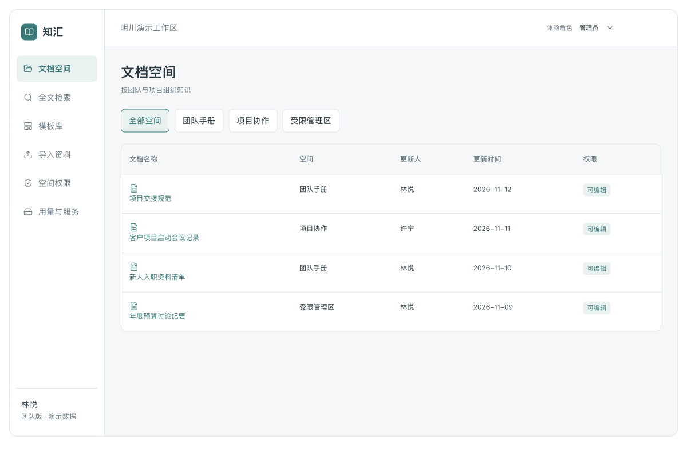
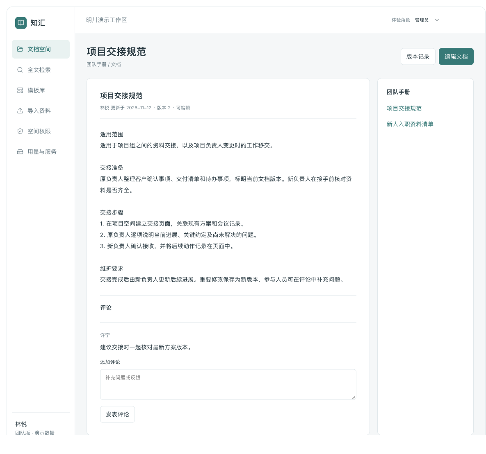
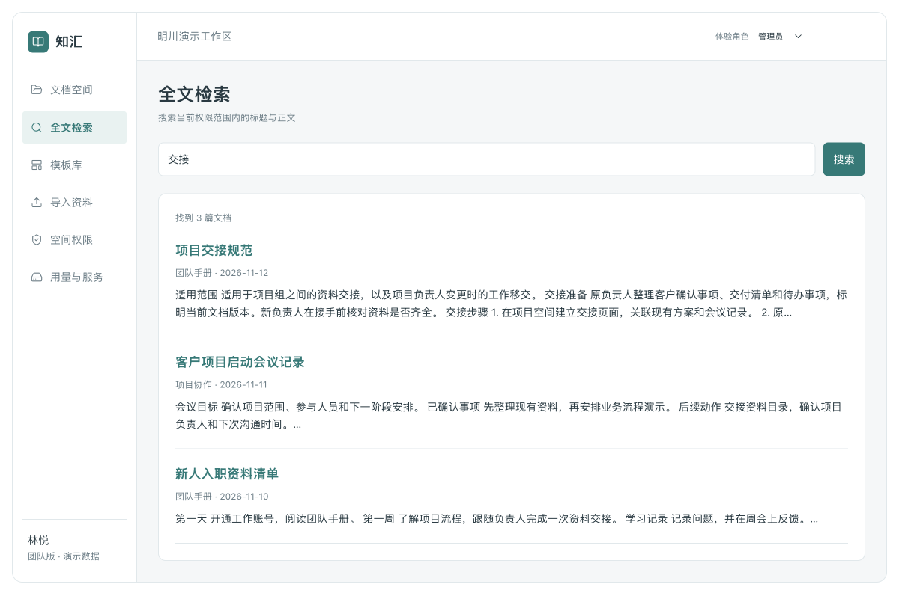
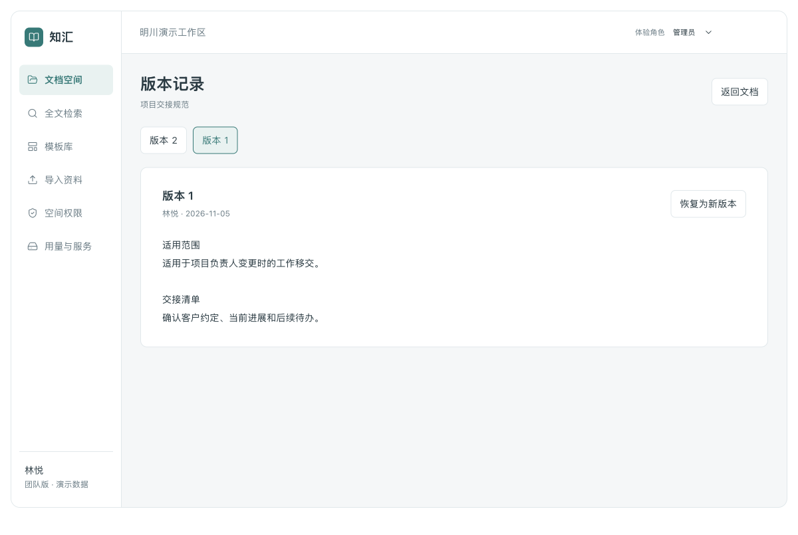
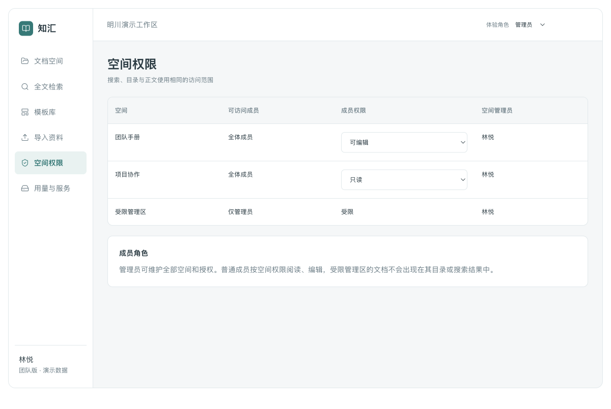
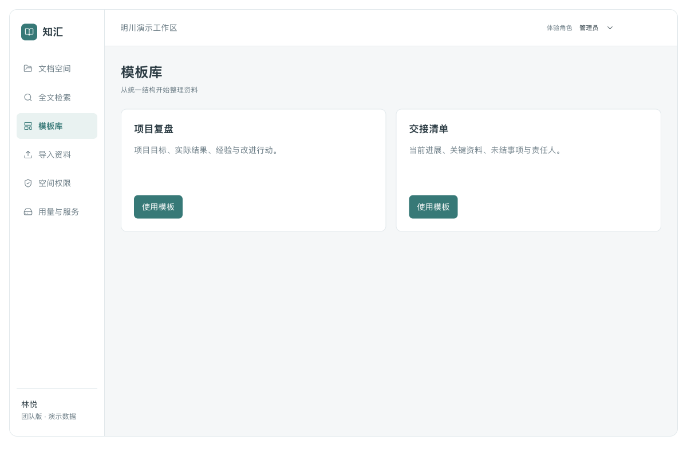
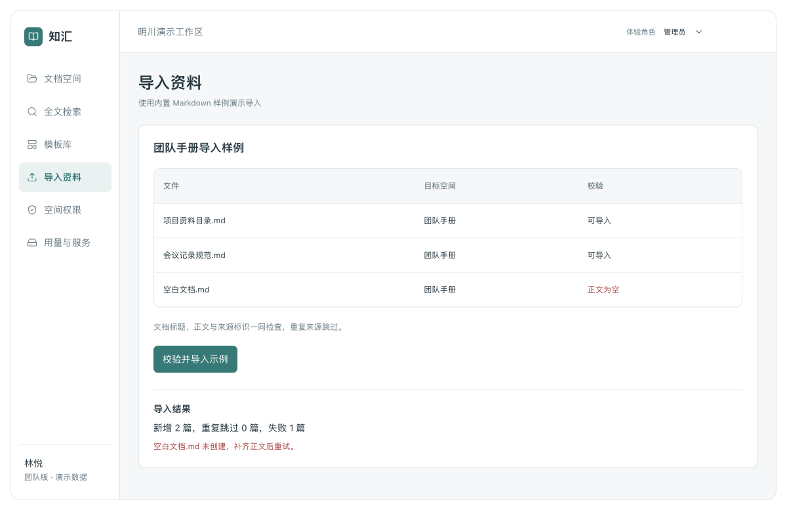
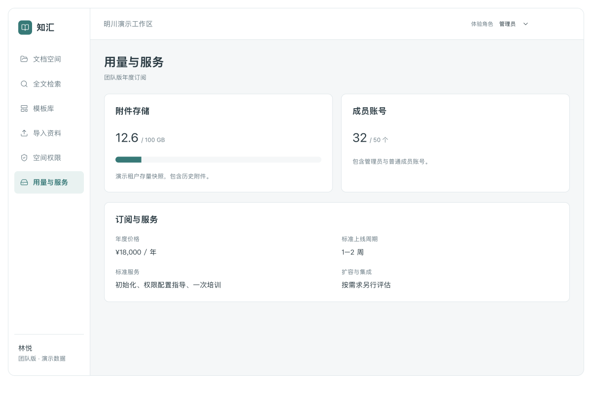

# 知汇企业知识库产品介绍书

销售培训资料草稿 v0.2，编写日期为 2026-11-12。

知汇企业知识库是为销售陪练编写的虚构企业软件。本文中的产品功能、价格、账号与容量额度、交付、试用及服务条款均为训练设定，供学员学习与查阅。功能形态参考真实知识管理产品的官方资料，参考依据见文末。

配套的 [知汇企业知识库产品界面演示](ui-prototype.html) 展示文档空间、全文检索、模板库、导入、空间权限和用量与服务。本文八张界面图来自这套演示，使用虚构文档与人员数据。演示覆盖部分核心操作，完整产品范围以本介绍书的文字设定为准。

## 产品概述

知汇帮助企业把制度、操作规范、项目经验和常用模板归集到可持续维护的文档空间。成员根据权限查阅资料、补充评论和更新正文，负责人通过版本记录了解内容变化，管理员维护空间权限、账号与容量。

团队版采用云端年度订阅，通过电脑浏览器使用，适合约 20–100 人、具有多个项目组或职能部门的企业。典型情况包括资料散落在群聊和个人电脑、新成员重复询问相同问题、项目组使用旧模板，以及重要经验随人员流动而难以保留。

产品使用效果依赖企业整理资料、明确内容责任人和建立更新习惯。知汇提供查找、协作和版本管理工具，具体能节省多少查找时间或培训成本，需要通过客户实际使用验证。

## 产品结构与核心功能

### 文档空间

空间按团队或业务主题组织资料，例如团队手册、项目协作和受限管理区。每个空间包含名称、说明、负责人、成员及访问权限，空间下的文档保持清晰的所属关系。

演示中的“团队手册”承载通用制度和工作指引，“项目协作”承载项目规范、会议结论与复盘经验，“受限管理区”承载仅向指定人员开放的资料。实际客户可在上线时按照组织结构和使用场景规划空间。

文档具有标题、正文、作者、更新时间和版本号，可按所属空间进入阅读。成员在有编辑权限的空间创建和维护内容，管理员统一处理成员及空间配置。

### 文档编写与保存

正文用于记录流程、说明和业务经验，标准文档支持常见文本结构，如标题、段落、列表、简单表格和链接。销售介绍时，应先了解客户最常维护的内容类型，再确认其格式是否适合标准编辑能力。

保存后的文档有明确的更新时间和版本信息。文档标题应能说明用途，正文适合包含适用范围、操作步骤、责任分工和必要的附件说明。模板为这些常用内容提供起始结构。

界面演示支持打开文档、编辑正文和保存新版本。复杂富文本布局、多人同时编辑时的冲突处理、离线编辑及其他专用编辑能力，需要在具体需求评估中说明。

### 全文检索

成员可以用关键词检索当前有权限访问的文档标题与正文，并查看匹配结果及所属空间。找到结果后进入文档核对上下文、版本和适用范围。

搜索始终按当前人员的空间权限执行。普通成员无法访问的受限空间及文档，也不会出现在该成员的检索结果中。切换为管理员后，界面可展示管理员有权访问的空间和内容。

标准检索以已收录的可识别文本为基础。扫描图片中的文字、加密附件、特殊格式文件或尚未完成处理的内容，需要进一步评估。跨外部网盘、邮件和其他系统的检索需另行确认授权与集成范围。

### 版本记录

文档保存后形成一个新版本，记录保存时间、修改人员及当时正文。阅读者可以根据权限查看历史内容，了解当前规范与旧版本之间的变化。

团队版保留最近 180 天的正文版本。需要更长保留期、专门审计导出或特定恢复方式时，应单独评估。此保留期是本训练产品的虚构设定。

演示可以打开版本记录、查看历史正文，并由有编辑权限的人员将所选历史正文恢复为新版本。恢复后，旧版本及现有评论继续保留，当前正文更新为所选内容。

### 评论协作

成员可在有权参与讨论的文档下添加评论，记录问题、修改意见或补充说明。评论应围绕具体内容展开，作者可以根据意见修订正文，再形成新的保存版本。

可读权限用于查看文档及已有评论，可编辑权限还允许添加评论和维护正文。管理员可按实际管理职责处理空间授权和内容维护。

界面演示展示文档级评论。内容中的引用、提及通知、逐段批注、讨论解决及跨工具通知等进一步协作能力，需要确认具体范围后评估。

### 模板库

模板为常见文档提供结构，适合新成员指引、项目说明、会议记录、操作规范和项目经验整理等重复场景。成员选用模板后，会在有编辑权限的目标空间生成一份独立文档。

模板可包含文档用途、适用人员、正文分节及待填写位置。创建者应补全实际业务内容、明确负责人并核对适用条件。后续调整模板不会自动改写已经创建的独立文档。

### 导入与迁移

标准产品支持把符合要求的文本和 Markdown 文件导入为知识库文档，保留可识别的文本结构。Word、HTML、附件及旧知识平台迁移，需要先提供样本确认可保留的结构和额外处理范围。

单个文件上限为 20 MB，一次标准导入最多 100 个文件。文件名或标题、目标空间、正文格式及重复处理方式需在导入前明确。复杂表格、脚注、外部图片、评论、历史版本和原系统权限可能需要专门迁移处理。

演示采用内置样例展示目标空间、校验、导入结果及重复跳过。完整迁移需要核对内容数量、失败原因和实际目录，避免重复执行后产生重复文档。

## 界面与操作说明

### 文档空间总览

空间总览提供进入不同资料主题的入口，成员可以选择一个空间查看其文档，再点击标题进入阅读。列表中保留标题、责任人及更新时间等识别信息，便于判断资料用途和维护情况。

| 对象 | 主要信息 | 业务用途 |
| --- | --- | --- |
| 空间 | 名称、说明、负责人、成员及权限 | 按团队或主题组织资料 |
| 文档 | 标题、所属空间、正文、作者、更新时间 | 记录具体知识并找到维护人员 |
| 版本 | 版本号、保存人、保存时间及历史正文 | 回看内容变化，核对曾经的规定 |
| 评论 | 评论人、时间、内容及所属文档 | 收集使用问题及修改意见 |
| 模板 | 模板名称、用途和预置结构 | 建立相似文档时减少重复整理 |

在产品演示中，管理员可以看到三个预置空间。普通成员进入总览时，仅看到其被授权的空间。空间列表和全文检索使用同一套访问规则。

### 文档阅读与编辑

打开文档后，可以查看正文、所属空间、作者及版本信息。需要修订时，由有编辑权限的人员进入编辑状态，核对修改后的正文，再保存为新版本。

以新成员指引类资料为例，正文可以写清账号申请、常用协作工具、资料位置和首周事项。负责人更新某个申请步骤时，应写出当前适用方法，并通过保存版本保留修改过程。

文档下方的评论用于集中收集阅读者的问题。例如，成员指出某个资料路径已变化，作者核实后更新正文，后续人员可以根据新的版本继续查阅。

| 操作 | 前提 | 保存后的变化 |
| --- | --- | --- |
| 阅读文档 | 对所属空间具有访问权限 | 查看当前正文和已有评论 |
| 编辑正文 | 对空间具有可编辑权限 | 修改内容待保存确认 |
| 保存文档 | 内容符合字段要求且仍有编辑权限 | 生成新版本，记录保存时间与人员 |
| 添加评论 | 对空间具有可编辑权限 | 评论独立加入当前文档的讨论记录 |
| 查看版本 | 对所属空间具有访问权限 | 打开所选历史正文，便于核对变化 |

### 搜索资料

在全文检索中输入与业务问题相关的关键词，查看匹配文档。可以先用明确的主题词，例如交付、入职、客户交接，再根据结果进入文档核对内容。

搜索结果中，标题帮助判断主题，空间路径帮助判断归属，匹配摘要帮助确认上下文。结果数量与当前账号权限有关，两个成员搜索相同关键词，可能看到不同范围的结果。

若找不到资料，需要检查关键词、内容是否已收录以及空间授权。管理员可以核对内容是否存在及谁有访问权限，数据迁移或格式处理问题则需检查导入结果。

### 版本回看

在文档中打开版本记录，按时间查看保存历史，选择某个版本阅读当时正文。该视图适合核对谁在什么时候修改了规范，以及某次业务发生时采用的内容。

版本号用于识别保存顺序。新版本形成后，当前文档展示最新正文，历史视图保留相应时间的内容。需要恢复时，先确认旧内容仍适用，再由具有编辑权限的人员选择“恢复为新版本”。操作会保留已有历史和评论。

保存版本解决正文变化的记录问题。文档是否经过业务审批、流程是否符合公司制度、内容是否可公开使用，仍需要客户明确相应的管理要求。

### 空间成员与权限

空间权限页面展示成员及其可读或可编辑授权。管理员可根据人员分工调整授权，避免本应仅供查阅的资料被随意改写，也确保维护人员能完成更新。

| 能力 | 系统管理员 | 普通成员可读 | 普通成员可编辑 |
| --- | --- | --- | --- |
| 看到授权空间 | 全部空间 | 所授权空间 | 所授权空间 |
| 阅读文档与已有评论 | 可以 | 可以 | 可以 |
| 搜索空间内容 | 可以 | 可以 | 可以 |
| 编辑正文 | 可以 | 无编辑授权 | 可以 |
| 添加评论 | 可以 | 无评论授权 | 可以 |
| 使用模板创建文档 | 可以 | 无创建授权 | 可以 |
| 向目标空间导入 | 可以 | 无导入授权 | 在授权空间内执行 |
| 调整空间成员权限 | 可以 | 由管理员维护 | 由管理员维护 |

权限改变后，成员的可见内容及可执行操作按新授权生效。演示可用角色切换观察受限空间的可见性，再在空间权限页查看具体授权。

### 使用模板建立资料

进入模板库，选择符合业务场景的结构，确认目标空间后创建文档。新文档继承目标空间的访问范围，创建者应先核对目标空间是否适合存放该内容。

例如，项目说明模板可包含项目目标、范围、责任分工、关键时间和交付清单，会议记录模板可包含议题、结论、行动项及责任人。模板提供起始结构，正文仍由客户填写和维护。

在多个项目中使用同一模板，可以帮助团队保持相似的资料结构。具体内容是否完整、业务结论是否正确，以及行动项是否执行，需要对应业务人员负责。

### 文档导入

导入时先确认目标空间，再检查待导入内容的标题、文件格式和正文。目标空间的权限会影响后续谁能找到和阅读这些资料。

演示用三条内置样例说明结果反馈。首次执行新增两份有效文档，一份因校验问题而失败。再次执行相同样例时，已导入的文档按示例标识跳过，失败项继续提示需补充的信息。

完整导入应分别显示新增、跳过和失败情况，并指出受影响文件及原因。部分文件已成功时，先核对实际创建结果，再修正失败数据重试。

### 用量与服务

用量与服务页面集中展示团队版的账号、容量和服务范围。演示中的容量为 100 GB，已用 12.6 GB，用于解释套餐信息和剩余额度。

12.6 GB 为固定的展示样例。文档编辑、新建或样例导入并未对应真实文件传输，演示中的用量数值保持为样例值。完整产品应按照实际存储口径统计文档与附件占用。

容量接近上限时，应先梳理大型附件、重复文件和保留需求，再确认清理、归档或扩容方案。清理数据前需要确认保留政策和导出要求，扩容后的容量与费用以书面确认范围为准。

## 数据迁移与内容维护

### 导入前准备清单

| 需要确认的事项 | 示例 | 对迁移的影响 |
| --- | --- | --- |
| 原资料类型 | 文本、Markdown、Word、附件 | 决定转换与校验方法 |
| 内容归属 | 团队手册或项目空间 | 决定目录与后续访问范围 |
| 标题与标识 | 文档标题、来源文件路径 | 便于检查重复和追踪来源 |
| 资料责任人 | 每个空间或主题的维护人员 | 便于确认内容仍适用 |
| 目录结构 | 主题分组和层级 | 影响阅读与查找习惯 |
| 原系统权限 | 谁可查看、编辑和管理 | 需在目标空间重新核对 |
| 附件与链接 | 本地图片、外链或内嵌对象 | 决定资源是否能完整展示 |
| 历史内容 | 评论、旧版本与归档文档 | 可能需要额外迁移安排 |

批量迁移前先选一个具有代表性的空间做样例验证，检查标题、正文、表格、图片、链接和权限。样例确认后再安排分批处理，并记录每批结果。

### 常见问题处理

| 情况 | 可能的影响 | 处理方式 |
| --- | --- | --- |
| 标题或正文为空 | 无法建立可用文档 | 补齐内容后重试 |
| 文件超过限制 | 单次处理失败 | 拆分文件或评估大文件迁移 |
| 相同来源重复导入 | 产生重复资料风险 | 先检查已创建结果，再选择跳过或整理 |
| 表格和样式复杂 | 部分排版需人工整理 | 简化样例，确认可保留的格式 |
| 图片路径失效 | 正文可以阅读但图片缺失 | 补齐资源并确认引用路径 |
| 评论或历史未迁移 | 无法直接回看原讨论和版本 | 先评估原系统导出能力及额外保存方式 |
| 权限不符合预期 | 成员找不到或能看到不应开放的资料 | 由管理员核对目标空间授权 |

### 持续维护方式

建议由客户为空间指定维护责任人，为制度、操作规范和项目资料确认更新节奏。内容发生变化时，维护人员更新正文并保留版本，过时内容按照客户约定的归档方式处理。

资料标题适合保持具体，文档中写出适用范围、责任人和必要的更新说明。对业务重复提问，可优先检查资料是否容易找到、步骤是否清晰和内容是否已过时。

## 业务场景与产品价值

| 客户遇到的情况 | 可介绍的能力 | 使用前提 |
| --- | --- | --- |
| 新成员经常问相同问题 | 统一团队手册、关键词检索和常用模板 | 有可用内容，明确维护责任人 |
| 项目组各自保存文件 | 文档空间、清晰归属和统一阅读入口 | 规划主题与资料分类 |
| 不清楚哪个版本适用 | 当前文档和历史版本记录 | 及时保存更新并确认业务适用性 |
| 文档修改意见散落在群聊 | 文档评论和正文维护 | 成员把讨论放到对应文档 |
| 不同人员需要不同访问范围 | 空间成员授权和权限一致的搜索 | 管理员维护人员及空间授权 |
| 重复建立相似项目资料 | 模板库和独立文档创建 | 模板结构与实际业务相符 |

这些能力帮助团队减少资料分散和重复整理，具体改善程度取决于内容质量、维护习惯和人员使用情况。销售可以在试用时围绕一组真实任务验证查找、阅读、修改和协作是否方便。

## 价格与商务条件

以下金额均为知汇训练产品的虚构含税人民币报价。

| 项目 | 团队版标准条件 |
| --- | --- |
| 年度订阅费用 | 18,000 元，服务期 12 个月 |
| 包含账号 | 50 个内部实名账号，管理员计入账号数 |
| 包含容量 | 每个企业 100 GB 共享存储 |
| 单文件限制 | 20 MB，超限需求单独评估 |
| 标准功能 | 文档空间、正文维护、全文检索、版本、评论、模板及标准导入 |
| 标准上线 | 基础空间规划、权限配置指导、样例导入检查和一次线上培训 |
| 付款方式 | 合同确认后预付年度费用，其他安排须审批 |
| 报价有效期 | 报价单出具后 30 天 |

实际启用 35 个账号时，仍按团队版年费 18,000 元计费。超过 50 个账号、需要额外容量或不同服务范围时，应按增购报价确认费用及服务期。

销售可按标准条件介绍和报价。折扣、赠送账号、额外容量、延长试用及额外实施均需经主管确认，以书面报价和合同为准。私有化部署、外部系统连接、单点登录和复杂迁移需单独评估。

### 试用安排

提供 14 天试用，最多 10 个账号及 2 GB 试用容量。试用可先导入少量经过授权的资料，用于验证空间结构、权限、搜索和日常维护方式。

试用前确定待验证的任务，例如普通成员查找一份项目规范、编辑人员更新正文并查看版本、管理员核对受限空间的访问。试用结束后，根据结果确认正式的使用范围、资料整理工作和上线计划。

## 上线与售后服务

### 标准上线流程

标准周期预计 1–2 周，从双方确认空间范围、客户提交账号名单及合格样例资料后开始计算。

1. 确认使用部门、业务资料类型、主要问题和试点范围。
2. 规划空间及维护责任人，核对哪些资料需要受限访问。
3. 开通账号并配置标准空间权限，由客户选取样例资料。
4. 指导导入样例，检查正文、格式、链接和访问范围。
5. 由试点成员完成查找、阅读、编辑、评论和版本回看验证。
6. 提供一次 2 小时线上培训，确认上线清单与支持联系人。

标准服务包含基础空间规划与配置指导、一次样例导入检查和上述培训。大量历史资料整理、文档重写、复杂平台迁移、定制开发或外部集成需单独评估费用与工期。

### 验收与支持

验收以双方确认的样例空间和操作清单为依据，例如指定账号可登录、空间授权正确、样例文档可阅读、允许编辑的人员可保存新版本、关键词可找到对应内容、普通成员搜索不到受限资料。

日常支持时间为工作日 9:00–18:00，通过在线工单提供咨询，首次人工响应在 1 个工作日内。问题解决时间根据影响范围、数据情况和处理方案沟通确认。

客户可按已确认的授权及格式安排资料导出。服务到期后的数据交付、保留期和账号访问安排应在续约或终止时书面确认。

## 常见产品问题

### 现有共享盘还能继续用吗

可以先从高频资料或一个试点团队开始归集。大型原始附件及外部专业系统中的资料，可先保留其管理方式并评估链接、迁移或集成需求，知识库中的入口及访问授权需要同步核对。

### 能把以前所有文件一次搬过来吗

先确认格式、数量、目录、附件、权限和历史记录要求，再安排样例验证。正式迁移按照确认后的批次和范围处理，复杂格式或原系统专有内容可能需要额外工作。

### 能保证搜到所有内容吗

成员可搜索当前有权访问、已收录且可识别的标题与正文。扫描图片、受限资料、外部系统内容或尚待处理的数据，需要核对各自条件及处理方式。

### 能支持部门之间隔离吗

可以按空间配置成员与可读、可编辑授权。上线前需要明确人员分组、跨部门共享以及管理职责，再用不同角色检查访问和搜索结果。

### 是否包含 AI 问答

团队版的标准检索为关键词查找。需要基于资料生成答案、引用定位、连接外部数据或配置 AI 服务时，应单独确认功能、模型、数据授权和费用范围。

### 是否可以替企业把全部资料整理好

标准服务提供结构和导入指导，客户负责确认内容正确、适用性和维护责任。文档重写、分类标注、资料清洗和长期知识运营可另行评估服务范围。

## 功能设计参考

空间与文档组织、保存版本的功能形态参考 Confluence 官方介绍，成员授权、评论和导入边界参考 Notion 官方说明。知汇的功能组合、搜索规则、版本保留期及全部商业数值为虚构训练设定。[Confluence 功能说明](https://www.atlassian.com/software/confluence/features)、[Confluence 文档版本](https://support.atlassian.com/confluence-cloud/docs/create-edit-and-publish-a-page/)、[Notion 权限](https://www.notion.com/help/sharing-and-permissions)、[Notion 评论](https://www.notion.com/help/comments-mentions-and-reminders)、[Notion 导入](https://www.notion.com/help/import-data-into-notion)

具体来源事实与设计取舍见 [知识库官方资料参考记录](../../../docs/research/knowledge-product-references.md)。
