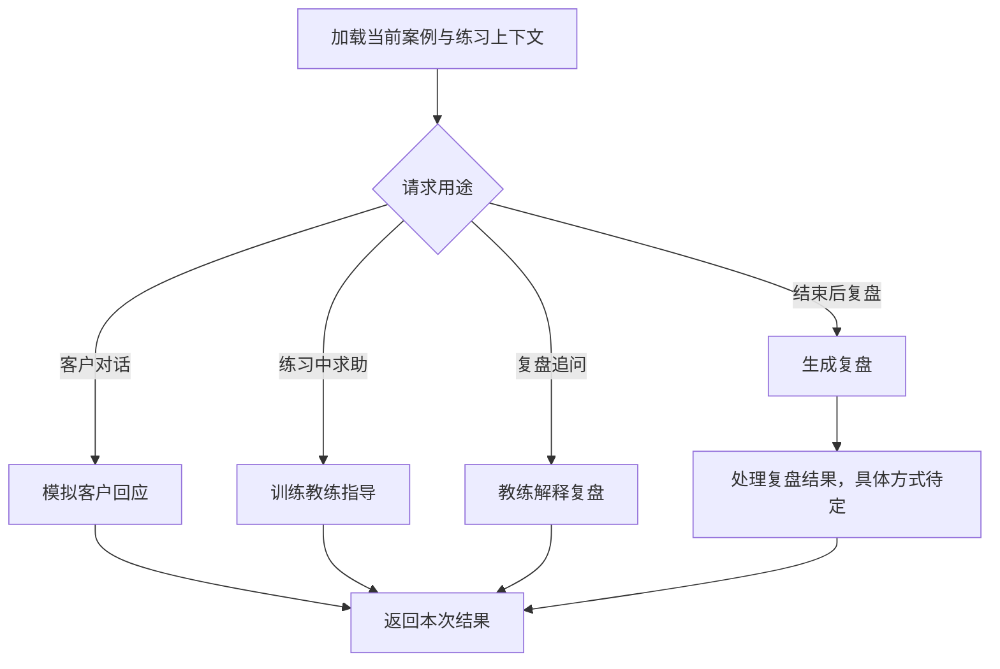

# 首版技术方案草稿

本文依据已确认的 [产品范围](product-scope.md) 提出实现方案。用户已指定前后端分离、后端 Python 与 LangGraph、PostgreSQL 数据库，以及 DeepSeek Flash。前端构建工具、Python API 框架及其余实现建议待整体确认。

2026-11-12 界面讨论补充。当前仅确认复盘页的原始聊天记录、复盘总结、教练助手三栏布局。下文有关总结生成、字段及教练上下文的描述仍为早期建议，具体实现待后续讨论。首版已取消逐字引用和引用定位的要求。新增的项目资料、收藏与开始时间展示以产品范围记录为准。

## 技术选型建议

| 部分 | 建议 | 用途 |
| --- | --- | --- |
| 页面与交互 | React、TypeScript、Vite | 独立前端项目，实现训练首页、练习页、复盘页和历史记录页 |
| Python 接口 | FastAPI | 接收前端请求、校验输入，将图执行结果和流式回复返回前端 |
| Agent 流程 | LangGraph | 组织案例加载、用途路由、客户回应、教练指导和复盘生成等节点 |
| 训练数据 | PostgreSQL | 由后端保存练习、对话、教练交流、复盘及完整练习进度 |
| 模型 | DeepSeek Flash，模型标识 `deepseek-flash` | 扮演客户，提供训练提示、复盘和复盘追问 |
| 运行方式 | 前端与 Python 后端分别在本地启动 | 用户在电脑浏览器中访问前端，由前端请求 Python API |

Vite 提供 React 与 TypeScript 项目模板，FastAPI 支持流式响应，LangGraph 以状态、节点和边组织执行流程。React、Vite 与 FastAPI 的组合是本项目的实现建议，PostgreSQL 按用户指定采用。[Vite](https://vite.dev/guide/)、[FastAPI](https://fastapi.tiangolo.com/advanced/custom-response/#streamingresponse)、[LangGraph](https://docs.langchain.com/oss/python/langgraph/overview)

## 前后端职责

- 前端负责四个页面、客户与教练聊天区域、流式内容展示，以及通过 API 创建、读取和更新练习。
- Python 后端负责接口校验、预设案例加载、模型上下文组装、LangGraph 执行、DeepSeek 调用，以及 PostgreSQL 数据读写。
- 开发时建议由 Vite 将 `/api` 请求代理到本地 Python 服务，前后端各自维护依赖和启动命令。
- 模型密钥通过 Python 后端环境配置读取。
- PostgreSQL 连接信息通过 Python 后端环境配置读取，由后端统一管理训练数据持久化。

## 请求与记录流程

1. 学员选择专项或完整练习，页面展示对应的预设任务与资料。
2. 点击开始后，由后端在 PostgreSQL 创建独立练习记录，保存案例起始情境和版本信息。
3. 学员发送消息时，将练习标识、本次消息、消息标识及请求用途提交给 Python API。
4. 后端从 PostgreSQL 读取当前练习所需的案例与记录，恢复图输入，由 LangGraph 路由到对应节点并调用 DeepSeek。
5. 回复片段逐步返回页面，最终消息与练习状态由后端写入 PostgreSQL，供历史回看或完整练习续练使用。
6. 结束练习后生成复盘，由后端保存报告及后续教练对话。

## LangGraph 流程建议

使用一个按请求用途分支的状态图，案例与练习类型作为输入。每次调用传入当前练习的独立状态。

请求按用途运行对应分支。客户节点使用客户对话上下文，教练节点按求助或复盘用途组装输入。需求沟通与方案介绍、商务谈判与合作推进两个专项及完整流程练习分别提供自己的案例起点与当前练习记录。

PostgreSQL 中的训练记录是历史回看和续练的恢复依据。后端按练习标识读取所需内容，并组装本次 LangGraph 调用的独立状态。图执行过程的检查点与训练记录的持久化职责将在详细设计中确定。[LangGraph Graph API](https://docs.langchain.com/oss/python/langgraph/graph-api)、[LangGraph 持久化](https://docs.langchain.com/oss/python/langgraph/persistence)

## 客户与教练的上下文

两种职责使用同一个 DeepSeek 模型，各自维护提示词和消息上下文。

| 用途 | 使用的内容 |
| --- | --- |
| 客户对话 | 当前案例的产品事实、客户设定和当前练习内的客户沟通记录 |
| 练习中问教练 | 当前练习中学员可见的案例资料、已完成的客户沟通记录，以及本次练习内的教练交流 |
| 生成复盘 | 当前练习的案例和已完成的客户沟通记录 |
| 复盘后追问 | 当前练习的对话、已生成的复盘，以及该次复盘的追问记录 |

上下文按练习标识读取。客户沟通记录、训练中教练交流和复盘追问分别保存，按各自用途组装模型输入。

## 模型调用建议

- 接口采用 DeepSeek 的 `POST /chat/completions`，模型固定为用户选定的 `deepseek-flash`。
- 客户和教练聊天采用流式回复，页面逐步展示已收到的内容。
- Python API 将 LangGraph 的目标节点输出转换为前端消费的文本片段、完成或错误事件。后端持久化最终消息与状态后返回完成事件，前端据此展示生成结果。具体流式 API 以安装版本的官方文档为准。[LangGraph 流式输出](https://docs.langchain.com/oss/python/langgraph/streaming)
- 首版建议显式设置 `thinking.type` 为 `disabled`，以非思考模式调用。此项是待确认的技术默认值，响应耗时需实际接入后验证。
- 复盘总结的内容、格式与生成方式待后续讨论。

DeepSeek 官方接口支持流式输出、JSON 输出和思考模式开关。JSON 输出需配合提示词，应用仍需检查返回内容的结构与完整性。[Chat Completion 接口](https://api-docs.deepseek.com/api/create-chat-completion/)、[思考模式](https://api-docs.deepseek.com/guides/thinking_mode/)

## 数据库记录与恢复

- 每场练习分配独立标识，由后端在 PostgreSQL 保存练习类型、案例版本及起始情境、对话、教练交流、复盘和状态。
- 原案例的起始资料随练习记录保存，后续回看和重练可沿用当时的情境。
- 每条消息使用稳定标识，区分生成中、已完成与失败状态。
- 建议按练习标识、消息标识与消息用途组织数据，使用事务及唯一约束保持消息写入、状态更新和重试的一致性。
- 流式输出中断时保留失败状态，重试沿用该次用户提问。已完成的消息构成后续正式对话上下文。
- 完整练习续练沿用原练习标识及其对话状态。
- 重练创建新的练习记录，恢复原案例起始情境，原记录继续保留供回看。

历史记录、续练及重练通过 Python API 读取 PostgreSQL 中的对应练习数据。

## 实现验证重点

- 两个专项与完整流程练习各自使用独立上下文。
- 客户和教练的输入框将消息发送给对应对象。
- 刷新或退出后，完整练习可恢复已保存的对话与状态。
- 重练恢复案例起点，并保留原练习记录。
- 复盘页可回看本次原始聊天记录，并提供总结区域和教练提问入口。
- 调用失败或流式中断后，可重试并保持消息记录一致。

## 后续语音接入

语音模型服务与交互方式按用户要求留待后续迭代。首版将页面交互、练习记录和模型请求分别组织，语音接入时可复用已有训练案例、会话记录及复盘能力。
